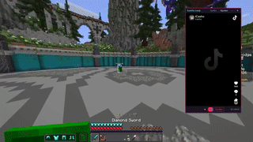

# Icasho Loop

<p align="center">
  <a href="docs/showcase.mp4">
    
  </a>
  <br>
  <a href="docs/showcase.mp4">Ver el video completo</a>
</p>

Reproductor flotante de escritorio que pasa en bucle y al azar los videos de un perfil de TikTok
(por defecto `@icasho`). La ventana se queda encima de todas las apps aunque hagas clic en otra.
Funciona en Windows y Linux (Wayland y X11). Hecha con Electron.

> Proyecto no oficial, sin relación con TikTok ni con el creador. Usa el reproductor embebido
> público de TikTok, que puede cambiar o dejar de funcionar.

## Instalación

Necesitas [Node.js](https://nodejs.org) 18 o superior (recomendado la LTS) y conexión a internet.

```
git clone https://github.com/noahazrz/icasho-loop.git
cd icasho-loop
npm install
npm start
```

Cambia `noahazrz` por tu usuario de GitHub. Sin git, descarga el zip desde el botón verde
**Code > Download ZIP**, descomprímelo y ejecuta `npm install` y `npm start` dentro de la carpeta.

### Windows

1. Instala Node.js LTS y abre una terminal nueva (`node -v` debe mostrar una versión).
2. Abre la carpeta del proyecto en el Explorador, escribe `cmd` en la barra de direcciones y pulsa Enter.
3. Ejecuta `npm install` y `npm start`.

Si sale "Electron failed to install correctly", tu npm bloqueó el script de descarga:

```
npm install-scripts approve electron
rmdir /s /q node_modules
npm install
npm start
```

### Linux

Los pasos son los mismos. Si npm no consigue instalar Electron, en Arch puedes usar el del sistema:

```
sudo pacman -S electron
electron .
```

Si Electron se queja del sandbox (Ubuntu 24.04 y similares): `npm run start:nosandbox`.

## Primer uso

1. Se abre el panel de Ajustes. Pulsa **Escanear videos**.
2. Una ventana oculta abre el perfil, baja hasta el final y guarda los videos. Si TikTok pide
   captcha o inicio de sesión, la ventana se muestra: resuélvelo y el escaneo sigue solo.
3. Empieza el bucle aleatorio. No repite hasta recorrer toda la lista y entonces vuelve a barajar.

La lista se guarda, así que no hace falta escanear de nuevo. Desde Ajustes puedes cambiar el
usuario o pegar enlaces de videos a mano.

## Controles

- **Fijado / Suelto**: activa o quita el "siempre encima".
- **Barra superior**: arrastra para mover. Los bordes cambian el tamaño.
- **Ajustes**: usuario, escaneo, enlaces manuales y transparencia.
- **Anterior, siguiente y sonido**: botones de la barra inferior.
- Teclas con la ventana enfocada: flecha derecha o espacio (siguiente), flecha izquierda (anterior), M (silencio).

## Wayland

Wayland no permite que una app normal se ponga "siempre encima". Por eso en Linux la app arranca
por XWayland, donde GNOME y KDE sí lo respetan. En algunos equipos eso pinta una ventana en
blanco; en ese caso usa Wayland nativo:

```
env ICASHO_NATIVE_WAYLAND=1 electron .
```

En ese modo el "siempre encima" depende de tu escritorio. En KDE, pulsa Alt+F3 con la ventana
enfocada y elige "Mantener encima de las demás", o crea una regla en Configuración del sistema >
Gestión de ventanas > Reglas de ventana.

## Crear instalador

```
npm run dist:win     # .exe instalador y portable (mejor ejecutarlo en Windows)
npm run dist:linux   # AppImage
```

El resultado queda en `dist/`. En algunos Windows hace falta activar el Modo desarrollador o
usar una terminal de administrador. El `.exe` no está firmado, así que SmartScreen mostrará un
aviso: "Más información" y "Ejecutar de todas formas".

## Problemas frecuentes

- **`npm` no se reconoce**: falta instalar Node.js o reabrir la terminal.
- **No aparece ningún video**: pulsa Escanear videos en Ajustes o pega enlaces a mano.
- **"TikTok no está cargando el reproductor"**: pulsa Reintentar. Si persiste, TikTok pudo cambiar el reproductor.
- **El video se silencia solo**: pulsa el botón de sonido. Si pasa en cada video, abre un issue con los detalles.
- **No se queda encima**: comprueba que el botón diga "Fijado" y revisa la sección de Wayland.

## Limitaciones

- Solo entran videos, no publicaciones de fotos.
- Los juegos en pantalla completa exclusiva pueden tapar la ventana.
- Probada en Linux con Wayland nativo. En Windows no se ha probado todavía.
